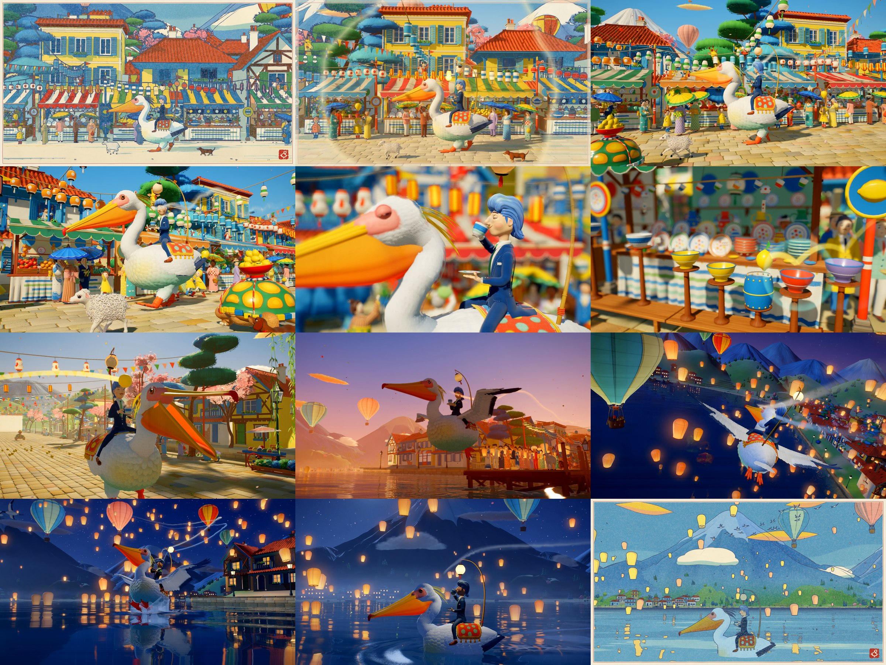

# The Tea Ride

An 81.6-second film about a young man drinking tea on a giant pelican. It plays live in the browser from **one HTML file**, and every note of its score moves something on screen.

It opens as a flat woodblock sheet: the colour blocks go down on four clacks, the sun switches on at 4.8 s, and the sheet breaks open into a 3-D world. The ride goes through a market, a tea break, a lemon chase, a run off the pier at sunset, a night flight through hundreds of lanterns and a landing on the lake, then closes back into a print with its seal. Then it loops.



## Pure three.js

- The only library is [three.js](https://threejs.org) r180, inlined into the page. No add-ons, no post-processing package, no physics engine, no audio library.
- No assets. There is no image, model, font or sound file in the page. Every mesh, texture, shader, movement and note is generated by code when the page loads.
- No network. It runs straight from disk.

## Watch it

Download `index.html` and open it in a desktop browser with WebGL 2. Press once to begin with sound.

| Input | Action |
|---|---|
| Tap anything | It answers, in key and on the next sixteenth |
| Tap empty air | Throws a lemon with real physics |
| Drag, scroll | Look around, zoom |
| `A` `S` `D` `F` `G` `H` `J` `K` `L` `;` | Play the koto |
| `B` `Q` `W` `E` | Drum, honk, sip, a rain of lemons |
| `R` | Ride along |
| `P` | Turn any moment into a woodblock print |
| `N` | Unroll the score under the picture |
| `Space`, arrows, `M`, `X` | Pause, jump, mute, full screen |

## The score moves the picture

One note list, `src/06_score.js`, is read by the synthesiser and by everything on screen. 100 BPM, 34 bars.

| Notes | What they move |
|---|---|
| Koto | The paper lanterns: one string of eight per bar, one lantern per pitch. In flight, the sky lanterns |
| Flute | The steam. The ribbon over the cup is the melody: height is pitch, width is breath |
| Marimba, bars 12-17 | A lemon in free fall. Every contact with the crockery is a written note; between contacts it is plain gravity |
| Bass | Awning cloth, trees, tail feathers, the riding lamp, rings round the floating bird |
| Taiko | Paving stones, the hand on the camera |
| Wood block | Shutters, parasols, claps |
| Bells | Rings on the water, stars |
| Chords | Balloon burners |
| Steps and wingbeats | Both fall on the beat; stones sink under each foot |

## How it is put together

Source lives in `src/` as plain scripts, concatenated in name order. `python3 tools/build.py` inlines three.js and the source into `dist/pelican-market-3d.html`; `index.html` is a copy of that file.

| File | What it makes |
|---|---|
| `00_util.js`, `02_sdf.js`, `04_sculpt.js` | Geometry kit, signed-distance shapes, sculpted and skinned bodies |
| `06_score.js` | The score, story cues, and the queries every moving thing asks |
| `08_look.js` | Palette, 18 materials, wind, soft shadows, light through thin things, print mode |
| `10_sky.js` | Dawn to moonlight, and a light field that lets hundreds of lanterns light the street |
| `16_path.js` | Where the pelican is at any moment |
| `30_phys.js`, `56_lemons.js` | Rigid lemons; the lemon that plays the tune |
| `40_pelican.js`, `42_rider.js`, `41_lamp.js`, `43_steam.js` | The two leads, their lamp, the singing steam |
| `44_beasts.js`, `46_folk.js` | Six animals; 159 townspeople |
| `50_arch.js`, `54_stalls.js` | Streets, houses, pier; stalls, cloth, the lantern strings |
| `60_land.js`, `64_water.js`, `66_air.js` | Mountains and plants; lake and splash; balloons, clouds, sky lanterns, birds |
| `80_post.js` | Ambient occlusion, sun shafts, depth of field, bloom, grade, the woodblock print |
| `85_audio.js` | Koto, flute, strings, drums, bells and every effect, synthesised sample by sample in a Worker |
| `87_scorestrip.js`, `88_film.js`, `89_player.js`, `90_main.js` | The unrolled score, shot list, live player, render loop |

On an Apple-silicon laptop it holds 60 frames a second at 3.7 megapixels, and it lowers its internal resolution by itself when frames run long.

## Build, test, render

```bash
python3 tools/build.py
```

The other scripts in `tools/` are the rig used while making the film: a headless-Chrome capture daemon (`capd.mjs`, `cap.py`), cost probes (`perf.py`, `tris.py`), numbers for the mix (`stems.mjs`, `listen.py`) and the frame-exact video render (`render.mjs`, `finish.py`). They need Node, Python 3 with Pillow and NumPy, a local Chrome, and ffmpeg for the last one.

## Credits

[three.js](https://github.com/mrdoob/three.js), MIT licence. The licence text is in `vendor/LICENSE`.
